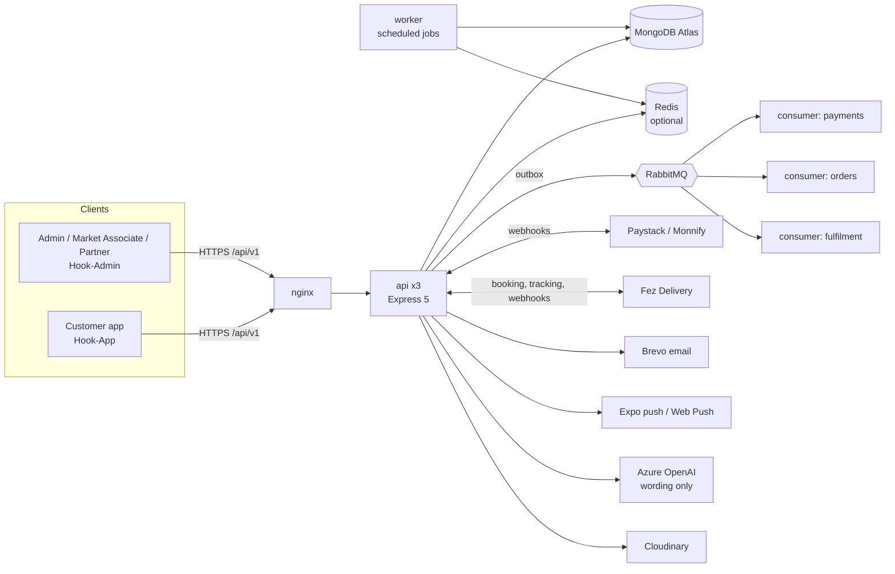

# Hook Backend

<p align="center">
  <strong>The commerce, fulfilment and negotiation API behind Hook, a Nigerian q-commerce marketplace that sources from physical markets and delivers to the customer's door.</strong>
</p>

Hook Backend is the single source of truth for the Hook platform. It serves the customer mobile app, the staff admin dashboard, the Market Associate and Partner web portals, and the payment and logistics webhooks. It owns catalog and pricing, AI-assisted price negotiation, checkout and payments, hub fulfilment, courier shipping, notifications, and the audit trail.

The product idea is simple: customers shop products that live in well-known markets such as Balogun and Tejuosho, Hook people source them on the customer's behalf, the goods pass through a Hook hub, and a courier delivers them. Most of the engineering here exists to keep that chain trustworthy: money is never double-charged, an order is never lost between two services, a price is never below what the business allows, and every state change is recorded.

## What This Backend Covers

- Customer accounts: email + password with OTP, Google and Apple sign-in, sessions, devices, addresses, account deletion with a cooling-off period
- Staff, Market Associate and Partner accounts with roles, granular permissions and State / hub scoping
- Catalog: categories, attribute templates, sizing guides, product submissions and review, published products, availability confirmation
- AI-assisted price negotiation with a deterministic pricing engine (the model only words the reply)
- Cart, checkout previews, coupons, Hook credit, delivery pricing, VAT, order splitting across fulfilment groups
- Payments through Paystack and Monnify hosted checkout, payment links, refunds and reconciliation
- Fulfilment: Market Associate sourcing tasks, handover codes, hub receiving, parcel receipts, consolidation, shipment booking
- Logistics through Fez Delivery: booking, tracking sync and signed webhooks
- Notifications: in-app, Expo push for the customer app, Web Push for staff browsers, transactional email through Brevo
- Realtime updates over Socket.IO
- Referrals, rewards, waitlist, banners, app-release policy for forced and optional updates
- Admin APIs for operations, finance, reporting and the audit log

## Core Product Value

Hook Backend turns a messy offline supply chain into an auditable digital workflow:

- **One order, many hands.** An order can be split across markets and shipments, each tracked on its own.
- **Prices the business controls.** Negotiation never goes outside the admin-set floor, whatever the model says.
- **No lost events.** Side effects go through a transactional outbox and are retried until they land.
- **Safe retries.** Money-moving requests require an `Idempotency-Key`, so a flaky network cannot double-charge or double-refund.
- **Everything attributable.** Staff actions write to an audit log with actor, entity and State / hub scope.

## Architecture



### Processes

The same Docker image runs four roles. The role is chosen by the command.

| Role | Command | What it does |
| --- | --- | --- |
| **API** | `node dist/server.js` | Serves HTTP and Socket.IO. Scale horizontally (production runs three replicas behind nginx). |
| **Worker** | `node dist/worker.js` | Runs the outbox drain, reconciliation and every scheduled job. BullMQ schedulers keep each tick single across replicas. |
| **Consumer** | `node dist/consumer.js` | Consumes one event domain from RabbitMQ (`EVENT_DOMAIN` = `payments`, `orders` or `fulfilment`). |
| **Dev** | `npm run dev` | API with the worker running in-process, restarted by nodemon. |

In production, set `WORKER_IN_PROCESS=false` on API instances and run the worker separately. Outside production the API runs jobs in-process by default so a single `npm run dev` is enough.

### Business modules

Code is organised into eight modules under `src/modules`. A module may only import another module through its public entry point (`@modules/<name>` or `@modules/<name>/public`); ESLint fails the build if one reaches into another's files.

| Module | Responsibility |
| --- | --- |
| `identity` | Auth, tokens, sessions, Google / Apple sign-in, invitations, addresses, access control, account deletion and erasure |
| `catalog` | Categories, products, submissions, availability, media, market vendors (suppliers), inventory settings, the pricing engine |
| `negotiation` | Offer flow, live rules, locked prices, abuse protection, Azure OpenAI wording, reconciliation |
| `orders` | Cart, checkout, order service, order splitting, coupons, credits, referrals, delivery pricing |
| `payments` | Payment service, payment links, Paystack and Monnify providers behind one interface |
| `fulfilment` | Sourcing tasks, hub packages, consolidation, receipts, shipments, Fez provider, logistics providers |
| `notifications` | In-app, push, email, staff alert rules, digests, engagement and waitlist messaging |
| `platform` | Outbox, event bus, realtime, audit log, public IDs, cache, bootstrap of roles and permissions |

## Key Backend Features

### Orders and fulfilment

An order moves through `CommerceOrderStatus`: `AWAITING_PAYMENT` → `VERIFICATION_PENDING` / `OPERATIONS_REVIEW` → `APPROVED_FOR_FULFILMENT` → `IN_FULFILMENT` → `PARTIALLY_RECEIVED` → `READY_FOR_CONSOLIDATION` → `READY_FOR_DISPATCH` → `IN_TRANSIT` → `DELIVERED` (plus `PARTIALLY_*`, `ON_HOLD`, return and refund states).

1. **Sourcing.** On approval, one fulfilment task per market is created and matched to the market's assigned Market Associate. Unclaimed tasks are re-matched every two minutes.
2. **Handover.** The associate gets a four-digit handover code for each package. The hub accepts the package only with the right code, and repeated wrong codes lock it.
3. **Hub receiving.** A received package goes straight to the Shipping queue. The hub quality-check step is switched off permanently.
4. **Receipt.** Once the hub has the goods, the customer can open a Hook parcel receipt with a QR code and barcode. Staff can print the label in A6, A4 or thermal sizes.
5. **Shipping.** Staff book a Fez shipment per parcel. The tracking number is visible to the customer as soon as it is booked, and a tracking sync runs every ten minutes alongside signed Fez webhooks.
6. **Settlement.** Webhook and staff updates settle split orders the same way, so one delivered shipment cannot mark the whole order delivered.

### Negotiation

Pricing is deterministic; the language model never decides a price.

- The **pricing engine** (`catalog/pricing-engine.service.ts`) works in integer kobo and enforces the admin floor, the maximum discount and the offer limit. Each round has an allowed price that steps from the list price down to the floor.
- An offer that meets the round's price is accepted. A lower offer gets a **counter**, never a flat refusal, including on the final round, which then closes at Hook's best price.
- A counter is the round's price plus a small, varying cushion (about 6–20% of the room above the floor), rounded to whole ₦100. It never rises above an earlier counter and is repeatable for the same offer in the same negotiation, so it is not simply "the lowest price".
- **Azure OpenAI** only phrases the reply, in English or Nigerian Pidgin. Replies are validated: the approved price must appear, no other amount may appear, nothing may hint at internal limits. On any violation a safe fixed wording is used, so a model outage never blocks a negotiation.
- Locked prices expire after a set time, are re-clamped against live product rules, and are cancelled if the product moves away from them.

### Payments and money

- All amounts are **integer kobo**. Display formatting happens at the edge.
- Hosted checkout through **Paystack** or **Monnify** behind a common provider interface. Payment links can be shared so someone else can pay for an order.
- Webhooks are verified, deduplicated and applied through the outbox. Payment and refund reconciliation jobs repair anything a webhook missed.
- **Hook credit** and coupons are applied in checkout and shown line by line on the order.
- VAT can be switched off in commerce settings; an order then records a rate of 0.
- Supplier bank account numbers are encrypted at rest.

### Reliability

- **Idempotency.** Financial and consequential mutations require an `Idempotency-Key`. A retry with the same key returns the stored result.
- **Transactional outbox.** Side effects (emails, push, effects of a confirmed payment) are written with the data change and delivered by the worker, or by RabbitMQ consumers when `EVENT_BUS_URL` is set. The worker drains every three seconds and is woken immediately after a write.
- **Redis is an accelerator, not a dependency.** Shared rate limits, the Socket.IO adapter and BullMQ use it when `REDIS_URL` is set. Without it everything falls back to MongoDB or in-memory. Production refuses a plaintext `redis://` URL to a remote host.
- **Graceful shutdown.** Every process closes connections cleanly and force-exits after 15 seconds so a redeploy never hangs.

### Identity and access

- Account types: `customer`, `staff`, `marketassociate`, `partner`.
- Short-lived access tokens (`JWT_EXPIRY`, default 15 minutes) with refresh tokens grouped into session families (default 30 days). Sessions can be listed and revoked per account.
- Staff access is built from roles, permissions and a **scope**: `global`, `multi_state`, `single_state`, `hub` or `self`. Built-in roles: Super Admin, Operations Lead, State Operations Manager, Commercial Manager and Officer, Catalog Reviewer, Dispatch Hub Manager and Officer, Logistics Officer, Customer Support Officer, Finance Officer, Management Viewer.
- Accounts are created by invitation, with a configurable invitation lifetime. Suppliers added by a Market Associate are active immediately and need no verification step.
- Customers can delete their account. A cooling-off window (default 14 days) allows cancelling, reminders go out, and a worker erases personal data afterwards.

### Notifications

| Channel | Used for | Config |
| --- | --- | --- |
| In-app | Every customer and staff event | Always on |
| Expo push | Customer app: order progress, offers, reminders | `PUSH_ENABLED`, `EXPO_ACCESS_TOKEN` |
| Web Push (VAPID) | Market Associate and Partner browsers | `VAPID_*` |
| Email (Brevo) | OTPs, invitations, receipts, order status | `BREVO_*` |
| Staff alert rules | Paid orders, ready-to-ship, task milestones, refunds, shipment moments, filtered by each account's permissions and scope | Permission-based |

Push receipts are polled so dead tokens are pruned. Engagement messages (abandoned cart, win-back, new-arrivals digest, availability digest) run on a schedule.

### Background jobs

Defined in `src/jobs/definitions.ts` and run by the worker.

| Job | Cadence |
| --- | --- |
| `outbox-drain` | every 3 s |
| `fulfilment-deadlines`, `negotiation-start-notifications` | every 5 s |
| `reconcile-payments` | every minute |
| `reconcile-refunds` | every 2 min |
| `partner-custody-sync`, `unheld-task-match` | every 2 min |
| `negotiation-scan` | every 5 min |
| `payment-reminders`, `fez-tracking-sync` | every 10 min |
| `abandoned-cart-scan`, `push-receipts`, `account-deletion-erasure` | every 15 min |
| `expire-unpaid-orders` | every 30 min |
| `account-deletion-reminders` | hourly |
| `availability-digest` | daily 07:00 |
| `new-arrivals-digest` | daily 09:00 |
| `winback-scan` | daily 10:00 |

## Tech Stack

- Node.js 22, TypeScript 6, Express 5
- MongoDB (Atlas) with Mongoose 9, transactions on a replica set
- Redis (ioredis) for rate limits, Socket.IO adapter and BullMQ, optional
- RabbitMQ (amqplib) for the domain event bus, optional
- Socket.IO for realtime
- Zod for request validation
- Paystack and Monnify for payments, Fez Delivery for logistics
- Azure OpenAI for negotiation wording, Cloudinary for media, Brevo for email
- Expo push and `web-push` (VAPID) for notifications
- `prom-client` metrics, Swagger UI for API docs
- `tsx --test` with `mongodb-memory-server` for tests
- Docker, nginx, Prometheus, Grafana, Loki, Alloy and Uptime Kuma for operations

## Environment Variables

Copy `.env.example` to `.env` and fill in values. Never commit real secrets. The tables list what each variable does; `.env.example` has the full list with comments.

### Required to boot

| Variable | Purpose |
| --- | --- |
| `NODE_ENV` | `development` or `production` |
| `PORT`, `API_PREFIX` | Listen port (4000) and route prefix (`api/v1`) |
| `MONGODB_URI` | MongoDB connection string. Must be a replica set (Atlas is) because checkout and shipping use transactions |
| `JWT_SECRET` | Signs access tokens. Long and random |
| `APP_URL`, `ADMIN_APP_URL` | Public URLs of the API and the admin web app, used in emails and payment redirects |
| `CORS_ORIGINS` | Comma-separated allowed browser origins |

### Security and encryption

| Variable | Purpose |
| --- | --- |
| `JWT_EXPIRY`, `JWT_REFRESH_EXPIRY` | Token lifetimes (15m / 30d by default) |
| `OTP_EXPIRY_MINUTES` | One-time code lifetime |
| `PACKAGE_CREDENTIAL_ENCRYPTION_KEY` | Encrypts hub handover codes at rest. Required in production |
| `VENDOR_PAYMENT_ENCRYPTION_KEY` | Encrypts supplier account numbers at rest |
| `RATE_LIMIT_*`, `AUTH_RATE_LIMIT_*`, `UPLOAD_RATE_LIMIT_*` | Window and max for general, auth and upload limiters |
| `JSON_BODY_LIMIT`, `FORM_BODY_LIMIT` | Body size caps |
| `ENABLE_API_DOCS` | Serve Swagger UI at `/docs` (off by default) |

### Infrastructure

| Variable | Purpose |
| --- | --- |
| `REDIS_URL`, `REDIS_KEY_PREFIX`, `REDIS_*_TIMEOUT_MS` | Optional Redis. Use `rediss://` for remote hosts |
| `RATE_LIMIT_STORE` | `memory` keeps limits per process |
| `EVENT_BUS_URL` | RabbitMQ URL. Unset means the worker drains the outbox itself |
| `EVENT_DOMAIN` | Set on consumers only: `payments`, `orders` or `fulfilment` |
| `WORKER_IN_PROCESS` | Run jobs inside the API. Default true outside production, false in production |
| `OUTBOX_WAKE` | Immediate outbox wake-up after writes |
| `IDEMPOTENCY_ENFORCE` | Leave on. Set `false` only while old clients without keys are still in the field |
| `MONGODB_CONNECT_RETRIES` | Startup connection retries |

### Integrations

| Group | Variables |
| --- | --- |
| Google sign-in | `GOOGLE_WEB_CLIENT_ID` (required for mobile verification), `GOOGLE_IOS_CLIENT_ID`, `GOOGLE_ANDROID_CLIENT_ID` |
| Paystack | `PAYSTACK_SECRET_KEY`, `PAYMENT_WEB_ORIGIN`, `PAYSTACK_CALLBACK_URL`, `PAYSTACK_APP_RETURN_URL` |
| Monnify | `MONNIFY_API_KEY`, `MONNIFY_SECRET_KEY`, `MONNIFY_CONTRACT_CODE`, `MONNIFY_BASE_URL`, `MONNIFY_CALLBACK_URL`, `MONNIFY_DISBURSEMENT_ENABLED` |
| Fez Delivery | `FEZ_SECRET_KEY` (also signs webhooks), `FEZ_USER_ID`, `FEZ_PASSWORD`, `FEZ_BASE_URL`, `LOGISTICS_FEZ_ENABLED` |
| Email | `BREVO_API_KEY`, `BREVO_FROM_EMAIL`, `BREVO_FROM_NAME` |
| Push | `PUSH_ENABLED`, `EXPO_ACCESS_TOKEN`, `VAPID_PUBLIC_KEY`, `VAPID_PRIVATE_KEY`, `VAPID_SUBJECT` |
| Media | `CLOUDINARY_*`, `CATALOG_SIGNED_MEDIA_ENABLED`, `CATALOG_MEDIA_MAX_BYTES`, `UPLOAD_*`, `ALLOWED_EXTERNAL_IMAGE_HOSTS` |
| Negotiation wording | `AZURE_OPENAI_API_KEY`, `AZURE_OPENAI_ENDPOINT`, `AZURE_OPENAI_DEPLOYMENT_NAME`, `AZURE_OPENAI_MODEL_NAME`, `AZURE_OPENAI_API_VERSION` |
| Seed admin | `SEED_ADMIN_EMAIL`, `SEED_ADMIN_PASSWORD`, `SEED_ADMIN_FIRST_NAME`, `SEED_ADMIN_LAST_NAME` |
| Account deletion | `ACCOUNT_DELETION_COOLING_OFF_DAYS` |

Hub quality check is not configurable. A received package always goes straight to Shipping.

## Getting Started

### Prerequisites

- Node.js 22+ and npm
- A MongoDB replica set (a free Atlas cluster works)
- Optional: Redis and RabbitMQ for the full production topology

### Install

```bash
npm install
cp .env.example .env   # then fill in MONGODB_URI, JWT_SECRET and the keys you need
```

### Seed data

```bash
npm run seed:super-admin   # the first staff account
npm run seed               # demo accounts, markets, booths, categories, catalog and operations data
```

`SEEDING.md` lists the seeded accounts, the shared development password and what each seed script creates. More targeted seeds exist for categories, banners, sizing guides, delivery fees and launch data (see Scripts).

### Run in development

```bash
npm run dev
```

The API listens on `http://localhost:4000`. Background jobs run in-process, so no separate worker is needed locally. Set `ENABLE_API_DOCS=true` to browse Swagger at `/docs`.

### Production build

```bash
npm run build
npm run start     # API
npm run worker    # background worker, in a separate process
```

## Available Scripts

### Run

| Script | Purpose |
| --- | --- |
| `npm run dev` | Nodemon API with in-process jobs |
| `npm run worker:dev` | Worker from source |
| `npm run start:debug` | API with the Node inspector |
| `npm run build` | Compile with `tsc` and rewrite path aliases |
| `npm run start` / `start:prod` | API from `dist` |
| `npm run worker` | Worker from `dist` |

### Quality

| Script | Purpose |
| --- | --- |
| `npm run lint` | ESLint, including module-boundary rules |
| `npm run format` | Prettier on `src` |
| `npm run test:reliability`, `test:negotiation`, `test:shipping`, `test:deletion` | Grouped test runs (see Testing) |
| `npm run docs:swagger` | Regenerate `swagger-spec.json` |

### Seeds

`seed`, `seed:super-admin`, `seed:categories`, `seed:catalog`, `seed:banners`, `seed:sizing`, `seed:delivery-fees`, `seed:launch-products`, `seed:launch-accounts`, `seed:demo-customer`, `db:seed-legal-content`, `db:seed-earn-settings`, `db:seed-market-associate-products`.

### Data maintenance (`db:*`)

Migrations and repair scripts, safe to read before running: `db:migrate-fulfilment-indexes`, `db:migrate-shipping-flow`, `db:migrate-market-fulfilment`, `db:backfill-product-ids`, `db:backfill-product-catalog`, `db:backfill-group-statuses`, `db:backfill-permissions`, `db:verify-indexes`, `db:report-duplicates`, `db:dedupe-negotiations`, `db:clear-stale-invitations`, `db:purge-sla`, `db:purge-exceptions`, `db:transfer-waitlist`, and `report:variants`.

A few scripts delete data (`db:clear-orders`, `db:clear-market-associate-uploads`, `db:remove-pod`). Check which database `MONGODB_URI` points at before running any of them.

## API Overview

Base URL: `/{API_PREFIX}` (default `/api/v1`). Responses use a `{ success, data, meta }` envelope (`meta` carries the request ID and pagination); errors carry a stable `code`.

| Prefix | Audience | Notes |
| --- | --- | --- |
| `/auth` | Everyone | Lookup, signup (start / verify / resend / complete), login, Google, Apple, OTP, refresh, logout, password forgot / verify / reset / change, invitations |
| `/` (customer router) | Customers | Profile, addresses, cart, checkout, orders, payments, negotiations, likes, credits, referrals, notifications, receipts |
| `/public` | Anyone | Catalog, categories, markets, States, banners, legal content, geography, app-release policy |
| `/admin` | Staff | Orders, products, submissions, fulfilment, shipping, hubs, markets, vendors, payments, refunds, customers, coupons, reports, roles, staff, settings, audit log |
| `/market-associate` | Market Associates | Assigned markets, suppliers, submissions, availability checks, fulfilment tasks, handover codes |
| `/partner` | Partners | Assisted checkout, offers, customers, custody |
| `/devices` | Signed-in users | Push token registration |
| `/catalog/media`, `/upload` | Authenticated | Signed media upload and file upload |
| `/webhooks` | Providers | Paystack / Monnify payment events, Fez logistics events (signature verified) |

Operational endpoints outside the prefix: `GET /health`, `GET /metrics` (Prometheus), `GET /docs` and `/docs-json` when docs are enabled. `ADMIN-API-REFERENCE.md` documents the admin surface in more detail and `swagger-spec.json` is the machine-readable spec.

### Conventions

- **Public IDs** are human-readable and sequential per year: `ORD-2026-000025`, `PRD-2026-000003`, `SHP-2026-000006`, `RCT-2026-000025`. Internal Mongo IDs are not exposed.
- **Money** is integer kobo everywhere. `totalMinor: 4579750` is ₦45,797.50.
- **Idempotency.** Send `Idempotency-Key: <uuid>` on checkout, payments, refunds, custody and similar mutations.
- **Soft delete.** Most records carry `deletedAt`; queries filter on it.
- **Validation.** Bodies are validated with Zod in `src/validations`; failures return `VALIDATION_ERROR`.

## Project Structure

```text
Hook-Backend/
├── src/
│   ├── server.ts            # API entry (HTTP, Socket.IO, optional in-process jobs)
│   ├── worker.ts            # Background worker entry
│   ├── consumer.ts          # RabbitMQ domain consumer entry
│   ├── app.ts               # Express app: security, CORS, routes, health, docs
│   ├── config/              # Env checks, MongoDB, Redis, Azure OpenAI
│   ├── modules/             # The eight business modules (identity, catalog, ...)
│   ├── controllers/         # HTTP controllers, grouped by audience
│   ├── routes/              # Routers: auth, customer, public, admin, platform-self, webhooks
│   ├── models/              # Mongoose models by domain (orders, fulfilment, catalog, ...)
│   ├── validations/         # Zod request schemas
│   ├── middleware/          # Auth, permissions, idempotency, rate limits, upload, validation
│   ├── jobs/                # Job definitions, BullMQ queue, in-process runner
│   ├── lib/                 # Constants, pure rules (negotiation, timeline, labels), crypto helpers
│   ├── emails/              # Email service and HTML templates
│   ├── notifications/       # Notification catalog
│   ├── database/            # Seeds, migration and maintenance scripts, category tree
│   └── utils/               # HTTP helpers, errors
├── tests/                   # ~50 test files (node:test + in-memory Mongo replica set)
├── deploy/                  # docker-compose, nginx, firewall, deploy.sh, monitoring stack
├── docs/                    # Runbooks, system maps, delivery guide, rollout notes
├── public/                  # Static assets served by the API
├── scripts/                 # Swagger generation and utility scripts
├── Dockerfile               # Multi-stage build, non-root, tini, health check
├── SEEDING.md               # Seed data and demo accounts
└── ADMIN-API-REFERENCE.md   # Admin API guide
```

## Testing

Tests use Node's built-in runner through `tsx` and start an in-memory MongoDB replica set per file.

```bash
npx tsx --test tests/*.test.ts               # everything, as CI does
npx tsx --test tests/negotiation-*.test.ts   # one area
npm run test:reliability                     # idempotency, payments, push, redis, fulfilment
npm run test:negotiation
npm run test:shipping                        # shipping flow + Fez
npm run test:deletion
```

Notes:

- Each file boots its own replica set, so a full run is memory and CPU heavy. On a small machine run files individually or by area.
- Tests must not depend on your `.env`. Unset `REDIS_URL` for a clean run so nothing tries to reach a remote Redis.
- CI (`.github/workflows/ci.yml`) runs `tsc --noEmit`, `eslint --quiet`, the build, the whole test suite and a Docker build on every push to `main` and `development` and on pull requests.

## Deployment

### Docker image

The `Dockerfile` is multi-stage: it builds with the full toolchain, prunes dev dependencies, and runs as a non-root user under `tini` with a `/health` check. One image serves the API, the worker and the consumers.

### Production topology (`deploy/docker-compose.yml`)

- `api-1`, `api-2`, `api-3`: API replicas
- `worker`: scheduled jobs
- `consumer-payments`, `consumer-orders`, `consumer-fulfilment`: event consumers
- `rabbitmq` (management UI) and `redis` (password-protected, append-only)
- `nginx`: TLS termination and load balancing on ports 80 and 443
- `deploy/monitoring`: Prometheus, Grafana, Loki, Alloy, node exporter, an alert mailer and Uptime Kuma

From the repository root there is a thin `docker-compose.yml` that includes the real stack:

```bash
docker compose up -d --build   # rebuild and restart after code changes
docker compose up -d
docker compose logs -f api-1
docker compose down
```

### Releasing

`deploy/deploy.sh <ref>` checks out an allow-listed ref, installs the firewall unit, builds the image, starts Redis and RabbitMQ, then rolls the services one at a time, waiting for each to report healthy. If a service does not become healthy it restores the previous image. The **Deploy** GitHub Action runs this over SSH after a green CI run: `main` deploys to production and `development` to the dev environment.

`docs/VPS-HANDOVER.md` is the step-by-step runbook for preparing a new Ubuntu VPS, configuring the environment and wiring GitHub Actions.

### Before going live

- Set `NODE_ENV=production`, a strong `JWT_SECRET`, and both encryption keys
- Point `CORS_ORIGINS`, `APP_URL`, `ADMIN_APP_URL` and the payment callback URLs at production hosts
- Use live Paystack, Monnify and Fez credentials and register the webhook URLs with each provider
- Use `rediss://` for Redis, set `WORKER_IN_PROCESS=false` on API instances and run the worker
- Keep `ENABLE_API_DOCS` off, or protect `/docs`
- Check that `/health` is green behind the load balancer and that Prometheus is scraping `/metrics`

## Documentation

| Document | What it covers |
| --- | --- |
| `SEEDING.md` | Seed command, demo accounts, booths, categories, catalog data |
| `ADMIN-API-REFERENCE.md` | Admin endpoints by area |
| `swagger-spec.json` / `/docs` | OpenAPI spec and Swagger UI |
| `docs/VPS-HANDOVER.md` | Server setup and deployment handover |
| `docs/negotiation-shopping-rollout.md` | How negotiation, price changes and wording fallbacks behave |
| `docs/Hook-Delivery.pdf` | Delivery integration guide |
| `docs/phase-01` to `phase-05`, `docs/reports` | System maps, route maps and the refactor history |

## Troubleshooting

- **"Transaction numbers are only allowed on a replica set member"**: your `MONGODB_URI` points at a standalone server. Use Atlas or a local replica set.
- **Redis connection errors in development**: unset `REDIS_URL`. Everything falls back to MongoDB and in-memory.
- **A request returns an idempotency error**: send an `Idempotency-Key` header on the mutation, or check the client is not reusing a key with a different body.
- **Webhooks rejected with 401**: the signature did not match. For Fez it is an HMAC with `FEZ_SECRET_KEY` over order number, status and timestamp.
- **Jobs not running in production**: the API does not run them by default there. Start the worker (`npm run worker`).
- **Tests hang or time out**: too many in-memory replica sets at once. Run by area or file, and unset `REDIS_URL`.

## Related Repositories

- **Hook-App**: the customer mobile app (Expo / React Native)
- **Hook-Admin**: the Next.js admin dashboard and the Market Associate and Partner portals

See `../Hook-Admin/README.md` and `../Hook-App/README.md`.

## Vision

Hook is built to make buying from busy physical markets as dependable as ordering from a modern store. The backend is where that promise is kept: prices stay inside the rules, money moves exactly once, parcels are accounted for from the stall to the doorstep, and every step leaves a record the team can trust.
